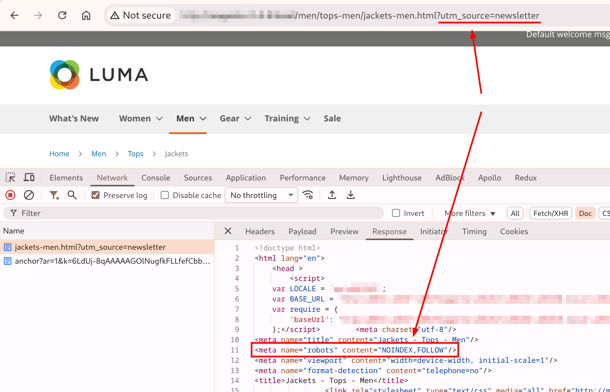
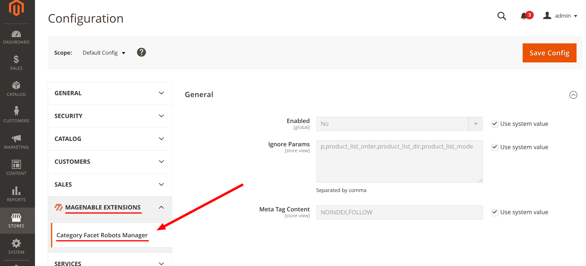

# Category Facet Robots Manager

**Category Facet Robots Manager** is a module for Magento 2/Adobe Commerce that provides the ability to add a noindex meta-tag to category pages with filters.



## Installation

### Composer:

Run the following command in the Magento 2 root folder

```
composer require magenable/module-category-facet-robots-manager
bin/magento setup:upgrade
bin/magento setup:di:compile
bin/magento setup:static-content:deploy
```

## Upgrade

### Composer:

Run the following command in the Magento 2 root folder

```
composer update magenable/module-category-facet-robots-manager
bin/magento setup:upgrade
bin/magento setup:di:compile
bin/magento setup:static-content:deploy
```

## User Guide

### Configuration:

Go to **Stores** > **Settings** > **Configuration** > **Magenable Extensions** > **Category Facet Robots Manager**.

#### General

- `Enabled` - Enable or Disable the module
- `Ignore Params` - URL parameters to be ignored (comma separated)
- `Meta Tag Content` - This content will be added to the meta-tag on category pages:<br>**\<meta name="robots" content="..."/>**



#### Compatibility
Tested with Magento Open Source 2.4.4 - 2.4.8, but will probably work with older Magento 2.X versions and Adobe Commerce

#### About developer
The extension is developed by Magenable (https://magenable.com.au), an eCommerce consultancy specializing in Magento/Adobe Commerce based in Melbourne, Australia
